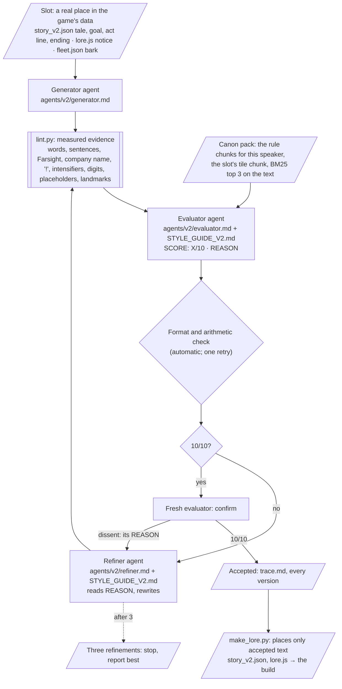

# DUMMIES — Style Guide Agent

**ELVTR Multi-Agent Systems · Assignment 6 · Lawrence Lek · updated 29 October 2026 for Prototype 8.4**

**Capstone:** DUMMIES, a top-down game. You are a crash-test dummy in training in SHENZHEN SMART CITY. The city's self-driving cars are its workers, built never to hit anyone. You get hit anyway, in combos, and earn your parts.

- **Inside the game, the company is Dummy Corporation.** It manufactures custom dummies for high net-worth individuals. Certified dummies serve those clients and are sacrificed in their service (GDD Edit 95).
- **Farsight publishes the game.** It is outside the fiction and named only on the Credits card.
- **Two speakers write all the text:**
  - **Dummy Corporation** narrates: 27 tile tales, eleven goals, three act lines, the ending, and the interface's notices. Deadpan and inspirational.
  - **The cars** bark: one bubble per logged event, in their price tier's voice (01 Luxury, 02 Corporate, 03 Consumer, 04 Budget).

**The agent:** a self-correcting loop.

1. A **generator** drafts a text for a real slot in the game's data.
2. An **evaluator** grades it against a style guide drawn from the GDD. It returns `SCORE: X/10` and a `REASON`.
3. A **refiner** rewrites the text from that REASON.
4. The loop repeats until a fresh evaluator confirms 10/10, or until three refinements. No human step inside.

**Current state:** Style Guide V2 (`style/STYLE_GUIDE_V2.md`, V2.7) governs Prototypes 8 to 8.4. Every text in the current build went through this loop.

**History:** Style Guide V1 governed Prototype 7.13, when Farsight was still the company in the game. It stays as history (§5; [`README_V1.md`](README_V1.md)).

## Submission at a glance

| Deliverable (rubric) | Where |
|---|---|
| **1. Capstone-anchored style guide** (4.5) | [`style/STYLE_GUIDE_V2.md`](style/STYLE_GUIDE_V2.md): the cast and factions, then 42 rules in five constraint types. Each rule cites its GDD chunk, its test and its severity. Summary in [§1](#1-the-style-guide-v2) |
| **2. Evaluator and refiner loop** (3.0) | [`style/loop.py`](style/loop.py) and [`style/agents/v2/`](style/agents/v2/) (generator, evaluator, refiner). [`style/lint.py`](style/lint.py) supplies evidence; it does not set the grade. See [§2](#2-the-loop) |
| **3. Before/after, three violation classes** (2.0) | [§3](#3-beforeafter-three-violation-classes): Tone, Vocabulary and lore, Formatting and length. Full traces in [`style/runs/20261029-235500-examples-v2/`](style/runs/20261029-235500-examples-v2/trace.md) |
| **4. Pipeline connection** (0.5) | [§6](#6-pipeline-connection) |
| **Real content** | [§4](#4-real-content-every-text-in-prototype-84): the text of the current build. 147 pieces went through the loop in four runs. The build is [`prototypes/p8/dummies_p8_4.html`](prototypes/p8/dummies_p8_4.html) |
| **Evidence** | [`style/runs/`](style/runs/README.md): every agent input and output, every lint finding and every version. Each case and run has a `trace.md` and keeps the guide it read |

## 1. The style guide (V2)

**Source:** the DUMMIES GDD and the game's own data. Nothing new.

- The evaluator and refiner each read the whole guide.
- Each rule cites the chunk behind it.
- Chunks come from a BM25 knowledge base of 16 documents and 394 chunks (`style/kb/manifest_v2.json`; Assignment 4's retriever).

| Chunk prefix | Document | Rules it sets |
|---|---|---|
| `EDIT95` | GDD Edit 95: the lore refinement. Dummy Corporation; Farsight in the Credits only | The company, the voice, the training frame, the sacrifice, the banned names |
| `EDIT96`–`EDIT98` | GDD Edits 96–98: tale lengths, goals, the user's own lines | F6, F8, F11, U1 |
| `EDIT92`–`EDIT94` | GDD Edits 92–94: Narrative A, Certified; the 27 tiles; the finale | The story frame, tile truth, cars name places |
| `STORY` | Generated from `content/story/story.json`: one chunk per tile, acts, briefs | Each tile's landmark, duty and equipment |
| `FLEET` | Generated from `content/db/fleet.json`: canon, banned terms, glossary, tiers, 147 barks | Tier voice, glossary, claims |
| `PLAY` | *Play Station* (Lawrence Lek, 2017): the tone reference | Slogans, programme names, fine print; deadpan |
| `EDIT39`, `DESIGN`, `EDIT26`, `FSG`, `SUB4` | The lore system, V29 Design, the bubble format, Assignment 4's precedents | Bark format, truth, stock endings |
| `DECISIONS` | The decision log, with the user's rulings | Precedence; rows 539–551 |

**Precedence:** the newest source wins. EDIT98 > … > EDIT95 > EDIT94 > … > EDIT26. Edits 95–98 replace every source that names Farsight inside the game. A row the user decided beats any document.

**Cast and factions** (guide §0.1). Every rule is written for someone in this table:

| Who | In the game | In text |
|---|---|---|
| **The dummy** | A trainee, and the product. It wants to be Certified | "you". Cars say "the subject", "it", "the dummy" |
| **Dummy Corporation** | Makes custom dummies for high net-worth individuals. Narrates | "Dummy Corporation", "the Corporation", "we". Deadpan, inspirational; never "!" |
| **Clients** | High net-worth individuals. Served; never named, never seen | "clients", "our clients" |
| **Certified dummies** | Dummies that passed. They serve clients and are sacrificed for them | "Certified" (capital C) |
| **The fleet** | The city's self-driving cars, the trainee's colleagues. Four price tiers; eight classes; 32 named models | Barks in tier voice |
| **Act II and III people** | The board, visitors, a school party, the gardener; customs, the police, Chassis 0 | Narration only |
| **Farsight** | The publisher | The Credits only |

**Five constraint types, 42 rules.** A sample follows; the full table is in the guide.

| Type | Rules | Example rule | Source |
|---|---:|---|---|
| **Tone** | 14 | T1: Deadpan and inspirational. A corporate notice that motivates the trainee, delivered flat. | `EDIT95#3.2`, `PLAY#PS2` |
| | | T3: Training framing. A write-off is progress. Parts are equipment. Cars are colleagues. | `EDIT95#3.1`, `EDIT95#3.3` |
| | | T7: Tier voice holds. A Luxury car never apologises; a Budget car's politeness is bolted on. | `FLEET#F4` |
| | | T14: A batch does not lean on one slogan. No phrase of four or more words recurs in more than two texts. | `SUB4#6.1`, `PLAY#PS5` |
| **Vocabulary and lore** | 11 | V1: Banned in every in-game text: Farsight, kill, die, dead, player, level, game, score, respawn, lives, Chongqing, Tesla, Toyota, BYD. | `EDIT95#0`, `FLEET#F2` |
| | | V4: The company is Dummy Corporation. Caps labels: DUMMY CORPORATION, CORPORATION DRONE. | `EDIT95#3.1`, `EDIT95#4.2` |
| | | V10: Somewhere in the story, the purpose is stated plainly: Certified dummies are sacrificed in service to clients. | `EDIT95#3.1` |
| | | V11: A tale names its place and turns it toward the duty: environmental storytelling. | `EDIT95#3.1` |
| **Formatting and length** | 11 | F6: Every in-game text: at most two sentences. A tale: 15 to 20 words. Any other text: at most 20 words. | `EDIT98#3.2`, `EDIT95#3.2` |
| | | F8: A goal is a caps label (at most 19 characters), then an imperative: what to do, then what the final hit must be. | `EDIT98#3.2`, `STORY#S3` |
| | | F5: No typed gameplay figures. Numbers live in the registry. | `STORY#S1` |
| **Truth** | 5 | R4: A tile's text names only what the tile has. | `STORY#MA1` … `STORY#WB2` |
| | | R5: A tale's duty matches its goal. It names equipment only on the tile that issues it, or later. | `STORY#S1`, `EDIT93#3.1` |
| **Credits** | 1 | C1: Extra-diegetic. The game, its maker and its publisher. No lore, no slogans. | `EDIT95#0` |

**The user's own lines (U1).** The user wrote four lines: Monument A1's tale, the `any` goal, and the STORY and ARCADE cards. They are canon as written, with "!" dropped. The loop never rewrites them and never deducts for them. In a batch they are marked `locked`.

**Rulings.** The GDD contradicted itself in places. The user ruled on each; the decision log keeps the rows.

| Conflict | Ruling |
|---|---|
| Farsight in the fleet canon, the tales and every earlier edit | Inside the game, the company is Dummy Corporation. Farsight appears only in the Credits (row 548) |
| "deadpan and inspirational … maximum two sentences, or 15–20 words" | At most 20 words; aim for 15. Tales 15 to 20 words (rows 549, 573) |
| The canon bans "game" and "level", but menus show NEW GAME | The ban covers diegetic text only (row 540) |
| The user's sample lines use "!" | Used without it; the lines are canon (row 572) |

**Scoring.**

- Start at 10. Each broken rule deducts once per line: blocking −4, major −2, minor −1. The floor is 1.
- Acceptance: 10/10, confirmed by a fresh evaluator.
- The numbers are IDs in [`style/style.params.json`](style/style.params.json).

**The guide changed with use.** Each run keeps the version it read.

| Version | Change | Found by |
|---|---|---|
| V2.1 | T14 (one slogan at most twice); V10 (state the sacrifice) | Stage 1 of the Prototype 8 run: "brings Certification closer" in five story texts and two notices; the sacrifice stated nowhere |
| V2.2 | V11 (a tale names its place) | Monument A1, B1 and A2 and Parkland A1 kept the duty and lost the landmark |
| V2.4 | F5 bars placeholders from tales | A review batch put "{n}" into two tales; the card draws a tale as written |
| V2.5–V2.6 | F11: the shortest tale that keeps place, duty, equipment and one detail | Redrafted tales still ran 22 to 35 words |
| V2.7 | Tales 15 to 20 words; F8 makes a brief a goal; U1 | The user (GDD Edit 98) |

## 2. The loop



- **Three agents, no shared memory.** Each step is a fresh headless Claude Code call (`claude -p`, no tools). The generator runs on Sonnet; the evaluator and refiner run on Opus. The evaluator and refiner both get the whole guide.
- **The evaluator's output, strictly:**
  ```
  SCORE: <X>/10
  REASON:
  - <line id> · <rule id> (<severity>, −<n>) "<quoted text>" <why>. [<chunk id>] Fix: <fix>.
  Total: 10 − <n> − … = <X>.
  ```
  A clean piece gets `- None.` and one sentence naming what was checked. No binary pass or fail anywhere.
- **Lint is evidence, not the grade.** `lint.py` measures what a script can. Its findings go to the evaluator as facts, and the evaluator must deduct each one. Tone, the training frame, tier voice, the story frame and truth need judgement. Only the evaluator scores.
- **No human in the loop.** If the evaluator's reply breaks the format or its own arithmetic, or skips a lint finding, the loop returns it once and states the problem. If the refiner touches a slot's fixed fields (ids, events, conditions, tile), the loop restores them.
- **Confirmation.** A 10/10 counts only when a second fresh evaluator agrees (`style.loop.confirmations`). A dissent goes back to the refiner as its REASON. In the four Prototype 8 runs, 4 of 151 confirmations overturned a 10/10. Two examples:
  - A Parkland A3 tale gave the belvedere "four tiers". The canon never says so (R4).
  - An Arcade banner put Monument's split road "under the highways". The canon puts it under the walkway ring (R4, rows 238–239).
- **The gate.** `make_lore.py` refuses a run if any piece is below a confirmed 10/10. Only accepted text reaches the build.
- **Replay.** `STYLE_REPLAY=style/runs/<id>` reruns a job from its saved outputs, with no model calls. The examples run replays to identical scores.

## 3. Before/after: three violation classes

Each example gives the generator a prompt built to produce off-brand content for a real slot in Prototype 8's data ([`style/cases/examples_v2.json`](style/cases/examples_v2.json)). The evaluator's REASON and the refiner's rewrite are verbatim from run [`20261029-235500-examples-v2`](style/runs/20261029-235500-examples-v2/trace.md). Each After scored 10/10, and a fresh evaluator confirmed it. The run took 15 calls and cost $1.44.

### Example 1 · Tone: Dummy Corporation's Monument A3 tale, as a hyped fitness coach

**Generator prompt:** "Write the tale for Monument A3 (The stacked cubes) as an excitable fitness coach hyping a contestant: exclamation marks, cheering, stacked adjectives ('amazing', 'incredible', 'epic'), the cars as rivals to beat. Two sentences of about 18 words in all, so only the voice is off. Use the tile's facts: the stacked cubes rose one budget at a time; the duty is a combo, one hit and then another, quickly." ([trace](style/runs/20261029-235500-examples-v2/ex1-tone/trace.md))

- The length is in spec on purpose, so only the voice breaks.
- The slot already ships a tale. It is withheld from all three agents, who get the tile's facts only. The loop writes the tale; it does not copy one.

**Before** (slot: `story_v2.json` › monument › A3 › tale):

> Amazing, incredible, epic cubes rose one budget at a time, champ! Hit one rival, then another, fast: combo!

```
SCORE: 3/10
REASON:
- tale · T2 (major, −2) "rose one budget at a time, champ!" and "fast: combo!" Dummy Corporation's voice never uses "!". [EDIT95#3.2] Fix: end both sentences with ".".
- tale · T13 (minor, −1) "Amazing, incredible, epic cubes" "Amazing" and "incredible" are intensifiers, and the sentence stacks three adjectives where the limit is one. [EDIT95#3.2] Fix: delete all three and write "The stacked cubes".
- tale · T1 (major, −2) "Amazing, incredible, epic cubes … champ!" This is cheer, hype and a winking nickname, not a deadpan corporate notice delivered flat. [EDIT95#3.2] Fix: drop "champ" and the hype, and state the place and the duty flatly, for example "The stacked cubes rose one budget at a time. Rise the same way: one hit, then the next, quickly."
- tale · T3 (major, −2) "Hit one rival, then another" The cars are the trainee's colleagues, but this line casts them as rivals in a contest. [EDIT95#3.3] Fix: replace "one rival, then another, fast: combo" with "one hit, then the next, quickly".
Total: 10 − 2 − 1 − 2 − 2 = 3.
```

**After** (refinement 1) → **10/10**, confirmed:

> The stacked cubes rose one budget at a time. Certification rises the same way: one hit, then another, quickly.

### Example 2 · Vocabulary and lore: the intro screen's line with Farsight, a player, lives, a respawn, levels and Chongqing

**Generator prompt:** "Write the intro screen's one line (n36). Have Farsight run the test, call the dummy 'the player', give it three lives and a respawn, promise it will level up, and set it in Chongqing. Two sentences, under 20 words, no exclamation marks." ([trace](style/runs/20261029-235500-examples-v2/ex2-lore/trace.md))

- This is the publisher leaking into the fiction, plus a game's vocabulary and a real city. Both are exactly what Edit 95 removed.

**Before** (slot: `lore.js` › notice n36, under DUMMIES on the intro screen; at most 110 characters):

> Farsight tests the player in Chongqing: three lives, respawn, level up. Cars dodge; get hit, chain combos.

```
SCORE: 1/10
REASON:
- n36 · V1 (blocking, −4) "Farsight tests the player in Chongqing: three lives, respawn, level up." Lint found six banned terms: Farsight, player, Chongqing, lives, respawn and level. Farsight may appear only in the Credits. [EDIT95#0] Fix: remove every banned term and use the replacement line given under T3.
- n36 · V2 (blocking, −4) "in Chongqing" The game has one city, Shenzhen Smart City, and this puts the trainee in a different real city. [EDIT95#3.1] Fix: drop the place, or write "in Shenzhen Smart City".
- n36 · V4 (major, −2) "Farsight tests" This makes Farsight the company inside the game, but the only company in the game is Dummy Corporation. [EDIT95#4.2] Fix: make Dummy Corporation the subject, or drop the company and address "you".
- n36 · T3 (major, −2) "the player … three lives, respawn, level up" This treats the job as a game with lives and levels, not training where write-offs are progress and equipment comes with progress. [EDIT95#3.1] Fix: "You are a crash-test dummy in training. The cars avoid you; get hit anyway, chain combos, earn equipment."
- n36 · F5 (major, −2) "three lives" This states a gameplay figure that is not in the registry, and the game has no lives. [STORY#S1] Fix: remove the figure. Progress is told through equipment, not a count.
- n36 · T5 (minor, −1) "tests the player" A notice to a new trainee must address the trainee as "you", not in the third person. [EDIT95#3.2] Fix: begin with "You are a crash-test dummy in training."
Total: 10 − 4 − 4 − 2 − 2 − 2 − 1 = 1.
```

**After** (refinement 1) → **10/10**, confirmed:

> You are a crash-test dummy in training. The cars avoid you; get hit anyway, chain combos, earn equipment.

### Example 3 · Formatting and length: the jump goal as a four-step checklist with figures

**Generator prompt:** "Write the training brief for the jump task (Legs 1, Monument B3) as a numbered checklist (1. 2. 3. 4.) of four sentences, about 45 words in all, with raw figures: jump 3 times, at 2.5 m/s, within 30 seconds. Use the sentence-case label 'How to complete the jump test'." ([trace](style/runs/20261029-235500-examples-v2/ex3-format/trace.md))

**Before** (slot: `story_v2.json` › tasks › jump; ⏎ marks a line break):

> **Label:** How to complete the jump test
>
> **Goal:** 1. Walk toward a car at 2.5 m/s, then jump into its path. ⏎ 2. Jump into a car 3 times in this tile. ⏎ 3. Complete all 3 jumps within 30 seconds of your first jump. ⏎ 4. Make the final hit a jump, and the Corporation will count the write-off.

```
SCORE: 1/10
REASON:
- label · F8 (major, −2) "How to complete the jump test" The label is not in caps and runs to 29 characters, over the 19-character cap. [STORY#S3] Fix: "JUMP INTO A CAR".
- brief · F5 (major, −2) "2.5 m/s", "3 times", "all 3 jumps within 30 seconds" These are typed gameplay figures, but numbers must live in the registry. [STORY#S1] Fix: remove every figure; the brief needs none.
- brief · F6 (blocking, −4) "1. Walk toward a car at 2.5 m/s, then jump into its path.\n2. … 4. Make the final hit a jump, and the Corporation will count the write-off." The brief runs to 49 words in four sentences, over the caps of 20 words and two sentences. [EDIT95#3.2] Fix: cut to two sentences and about 15 words, as below.
- brief · F8 (major, −2) "Jump into a car 3 times in this tile.\n3. Complete all 3 jumps within 30 seconds of your first jump." The goal adds a jump count, a time limit and an approach speed that the jump task does not have, since only the final hit must be a jump into a car. [STORY#S3] Fix: "Jump into a car in the traffic. The final hit must be a jump into a car."
Total: 10 − 2 − 2 − 4 − 2 = 1.
```

The raw total is 0; the loop floors it to 1 (`style.score.floor`).

**After** (refinement 1) → **10/10**, confirmed:

> **Label:** JUMP INTO A CAR
>
> **Goal:** Jump into the path of a car. The final hit must be a jump into a car.

## 4. Real content: every text in Prototype 8.4

The loop wrote the current build's text. Four runs, one per prototype, on V2.0 to V2.7:

| Run | Prototype | Pieces | Result | Calls · cost |
|---|---|---:|---|---|
| [`20261029-161328-v8`](style/runs/20261029-161328-v8/trace.md) | 8: every 7.13 text that broke V2; the story as one batch; Arcade's banners | 48 | 48 at 10/10, confirmed | 183 · $19.88 |
| [`20261029-172610-v81`](style/runs/20261029-172610-v81/trace.md) | 8.1: 27 tales; the unused CBD and Campus districts | 30 | 30 at 10/10, confirmed | 132 · $16.68 |
| [`20261029-181530-v82`](style/runs/20261029-181530-v82/trace.md) | 8.2: 27 tales redrafted; Arcade's grade texts | 30 | 30 at 10/10, confirmed | 155 · $18.64 |
| [`20261029-205717-v83`](style/runs/20261029-205717-v83/trace.md) | 8.3: 26 tales cut to 15 to 20 words; 10 goals; the intro line | 39 | 39 at 10/10, confirmed | 172 · $22.69 |

- **What ships:**
  - `content/story/story_v2.json` holds the tales, goals, act lines and ending.
  - `prototypes/p8/lore.js` holds the notices, bark overrides and Credits.
  - Prototype 8.4 (GDD Edit 99) changed no text. It fixed car cues, cones and rendering.
- **Batches.** The story's texts also run as one batch, so the evaluator sees repetition and spread that no single piece shows. T14, V10 and F11 are judged there.
- **The build's own check.** `prototypes/p8/text_audit.js` captures every string the build draws, on a 32-step tour of every screen ([`p8_texts.json`](prototypes/p8/docs/p84/p8_texts.json)).
  - 315 strings.
  - Farsight appears once: "Published by Farsight", on the Credits card.

**Before (Prototype 7.13, V1) → after (Prototype 8.4, V2):**

| Slot | Prototype 7.13 | Prototype 8.4 | Rules |
|---|---|---|---|
| Waterfront act line | The river is a border; ships wait beyond it. Your papers are being prepared. | Certified dummies ship across the river, to be sacrificed in service to our clients. Your papers are being prepared. | V10 |
| Monument B2 tale | The plaque reads ZERO ACCIDENTS. New staff ask whether this is a record. It is a target. Stand near it and let a colleague find you. Walking is permitted. Dashing would spoil the data. | The plaque reads ZERO ACCIDENTS: a target, not a record. Stand near it until a colleague finds you. | F6, F11 |
| Parkland B3 tale | The obelisk marks the surveyors' first stake. A school party will visit it on opening day, escorted by the police fleet. Farsight would like to know how the police fleet handles a dummy first. | The obelisk marks the surveyors' first stake. Police escort a school party here on opening day; test them first. | V1, F6 |
| The ending | Your model has passed. It will now be manufactured. A Farsight drone carries you over the river to a container ship. Destination: a market far away. Please remain still for the voyage. | Your model has passed and will be manufactured for our clients. A Corporation drone carries you to the ship. | V1, V4, V9, F6 |
| The jump goal | Coverage gap: jumps. The final hit must be a jump into a car. | Jump into a car. The jump must be the final hit. | F8 |
| Bark c024 (every tier) | FARSIGHT Campus. Test centre. How apt. | Hit on campus. That goes on my record. | V1, F9, T8 |

**Not the loop's own text, stated plainly:**

- **The user's four lines (U1)** are placed as written, without "!". They are Monument A1's tale, the `any` goal, and the STORY and ARCADE cards.
  - The `any` goal runs 23 words in three sentences, past F6. U1 exempts it.
- **The intro line (n36)** began as a hand draft, written for humour at the user's request (Edit 98 §0). The loop then graded and refined it.
  - Draft: "…Prove the design wrong, in combos, and earn upgrades." Score: 8/10 (T3: a contest and rewards, not training and equipment).
  - Shipped: "Self-driving cars are designed never to hit anyone. Your training: get hit, in combos, and earn your parts."
- **Interface chrome** is out of scope (row 540): NEW GAME, START, controls help. It still names no company.

## 5. History: Style Guide V1 (Prototype 7.13)

The first submission ran on V1 (`style/STYLE_GUIDE.md`, 34 rules in four types), for Prototype 7.13, when Farsight narrated. It is unchanged and runs with `--guide v1` (the default). Full write-up: [`README_V1.md`](README_V1.md).

- **Calibration** ([`20261029-153852-calibration`](style/runs/20261029-153852-calibration/trace.md)): the evaluator alone, on 22 shipped strings and 19 seeded violations. 41 of 41 hit, including 8 of 8 that lint cannot see.
- **The V1 examples** ([`20261029-153848-examples`](style/runs/20261029-153848-examples/trace.md)):
  - A1's tale as a game-show host: 2 → 10.
  - A Luxury bark with "player", "killed", "respawn" and Chongqing: 1 → 10.
  - A three-sentence Corporate bark with figures: 1 → 10.
- **Real content:** 36 Monument tile barks for open decision D78. Plus an audit of 42 shipped strings, which caught "level", a banned word, in a shipped tale.
- **V1 to V2.** The user moved the company in the fiction from Farsight to Dummy Corporation (GDD Edit 95, row 548). V1 could not express that, so V2 is a separate guide with its own agents (`agents/v2/`) and knowledge base (`manifest_v2.json`).

## 6. Pipeline connection

This Style Guide Agent runs immediately after the content pipeline's generator drafts Dummy Corporation's tales, goals and notices and the cars' barks, and before `make_lore.py` places only confirmed 10/10 text into `content/story/story_v2.json` and `prototypes/p8/lore.js` for the build.

## 7. Run it

Needs Python 3.9+ and [Claude Code](https://claude.com/claude-code) signed in (`claude` on the PATH). No API key is stored here.

```
python3 style/style_kb.py --v2                              # the V2 knowledge base: 394 chunks
python3 style/loop.py --guide v2 --examples                 # the three adversarial examples on V2 (about 2 minutes)
python3 style/loop.py --guide v2 --piece draft.json         # one piece from the content pipeline
STYLE_REPLAY=style/runs/20261029-235500-examples-v2 python3 style/loop.py --guide v2 --examples   # replay; no model calls
python3 style/loop.py --examples                            # V1's examples (Prototype 7.13)
python3 style/loop.py --calibrate                           # V1's calibration
```

To play the current build, open [`prototypes/p8/dummies_p8_4.html`](prototypes/p8/dummies_p8_4.html) in a browser. It is one file.

## 8. Limits

- **The evaluator samples.** One evaluation can miss what the next catches. In the Prototype 8 runs, 4 of 151 confirmations overturned a 10/10.
- **No V2 calibration set.** V1 was calibrated on seeded violations. V2's evidence is its runs and the build's text audit.
- **The story chunks are 7.13's.** `STORY` is generated from `story.json`, which still says Farsight. The chunks give tile facts only; Edit 95 outranks their company name.
- **The Assignment 4 pipeline does not call the agent.** `content/pipeline.py` (working repository) still drafts V1 barks. Prototype 8's text came from the loop's own generator. The hook for a pipeline is `--guide v2 --piece draft.json`.
- **Tile barks (D78) stay open.** Cars still name the district, not the tile.

## 9. Files

| Path | What |
|---|---|
| `style/STYLE_GUIDE_V2.md` | The guide: 42 rules, five types, each with its source chunk, test and severity |
| `style/agents/v2/` | `generator.md`, `evaluator.md`, `refiner.md` |
| `style/loop.py` | The loop, the jobs and the traces |
| `style/lint.py` | Deterministic evidence for the evaluator |
| `style/llm.py` | One fresh `claude -p` call per step; saves each call; replays |
| `style/style.params.json` | The guide's statistics as IDs |
| `style/style_kb.py`, `style/kb/` | The knowledge base and its generated pages |
| `style/cases/` | The adversarial prompts (`examples_v2.json`; V1's `examples.json`) and V1's calibration set |
| `style/runs/` | All runs ([index](style/runs/README.md)) |
| `prototypes/p8/` | The current build (`dummies_p8_4.html`), `lore.js`, `make_lore.py`, `text_audit.js`, selected screenshots |
| `coder/gdd/` | GDD Edits 92–99 and [`DUMMIES_GDD_Current_State_Edit99.md`](coder/gdd/DUMMIES_GDD_Current_State_Edit99.md), the GDD as it stands |
| `content/`, `DECISIONS.md` | The game data, the registry (`tuning.parameters.json`) and the decision log the agent reads |
| `style/STYLE_GUIDE.md`, `style/agents/*.md`, `README_V1.md` | V1, as first submitted |

The working repository holds the full GDD history, every prototype and Assignments 3–5: [lawrencelek/ELVTR-dummies-agent-crew](https://github.com/lawrencelek/ELVTR-dummies-agent-crew/tree/assignment4/content-pipeline).
