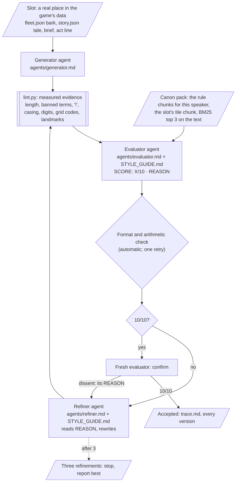

# DUMMIES — Style Guide Agent

**ELVTR Multi-Agent Systems · Assignment 6 · Lawrence Lek · 29 October 2026**

**Capstone:** DUMMIES, a top-down game. You are a crash-test dummy in SHENZHEN SMART CITY, run by Farsight. The city's self-driving cars are its workers. They train not to hit you. You try to get written off. Two speakers write all the game's text:

- **The cars** speak in barks: one bubble per logged event, in their price tier's voice (01 Luxury, 02 Corporate, 03 Consumer, 04 Budget).
- **Farsight** narrates the Story (Narrative A, Certified): 27 tile cards, their briefs, three act lines and the CERTIFIED ending.

**The agent:** a self-correcting loop. A **generator** drafts a bark or a piece of Farsight's copy. An **evaluator** grades it against a style guide drawn from the GDD and returns `SCORE: X/10` and `REASON:`. A **refiner** rewrites it from the REASON. The loop repeats until a fresh evaluator confirms 10/10, or three refinements. No human step inside.

## Submission at a glance

| Deliverable (rubric) | Where |
|---|---|
| **1. Capstone-anchored style guide** (4.5) | [`style/STYLE_GUIDE.md`](style/STYLE_GUIDE.md): 34 rules in four constraint types. Each rule cites its GDD chunk, its test and its severity. Summary in [§1](#1-the-style-guide) |
| **2. Evaluator and refiner loop** (3.0) | [`style/loop.py`](style/loop.py), [`style/agents/`](style/agents/) (generator, evaluator, refiner), [`style/lint.py`](style/lint.py) (evidence, not the grade). [§2](#2-the-loop), [§3](#3-calibration-does-the-evaluator-grade-like-the-game) |
| **3. Before/after, three violation classes** (2.0) | [§4](#4-beforeafter-three-violation-classes): Tone, Vocabulary and lore, Formatting and length. Full traces in [`style/runs/20261029-150755-examples/`](style/runs/20261029-150755-examples/trace.md) |
| **4. Pipeline connection** (0.5) | [§6](#6-pipeline-connection) |
| **Real content** | [§5](#5-real-content-for-the-game): 36 new tile barks for an open decision (D78); an audit of all 42 shipped Farsight strings |
| **Evidence** | [`style/runs/`](style/runs/README.md): every agent input and output, lint finding and version; a `trace.md` per case and run; the guide each run read |

## 1. The style guide

**Source:** the DUMMIES GDD and the game's own data. Nothing new. The evaluator reads the guide whole and cites the chunk behind each rule. Chunks come from a BM25 knowledge base built from the GDD (Assignment 4's retriever, 356 chunks):

| Chunk prefix | Document | Rules it sets |
|---|---|---|
| `EDIT92`, `EDIT93`, `EDIT94` | GDD Edits 92–94: Narrative A, Certified; the 27 tiles; the finale; R-BARK-TILE rejected | Farsight's voice, the story frame, tale shape, cars name places not codes |
| `STORY` | Generated from `content/story/story.json`: acts, briefs, one chunk per tile | Tile truth, brief format, act lines |
| `FLEET` | Generated from `content/db/fleet.json`: canon, banned terms, glossary, tiers, 147 shipped barks | Tier voice, banned words, glossary, claims |
| `EDIT39`, `DESIGN`, `EDIT26` | GDD Edit 39 (lore system, bark bubbles), V29 Design D9.3 (voice and truth), Edit 26 §3.2, §6.6 | Car voice, truth, bubble format |
| `FSG` | FARSIGHT Style Guide: field text, reserved inks | 48-character bubble, one ink |
| `SUB4` | Assignment 4's critic precedents | Tier-free lines, invented consequences, stock endings |
| `DECISIONS` | The decision log, including Lawrence's four rulings for this guide (rows 539–542) | Farsight's casing, the ban's scope, "!" by speaker |

**Four constraint types, 34 rules.** A sample (full table in the guide):

| Type | Rules | Example rule | Source |
|---|---|---|---|
| **Tone** | 12 | Farsight is dry corporate comedy: polite, procedural, dry. Cars are colleagues; briefs are duties; parts are equipment. No exclamation marks. | `EDIT92#3` |
| | | Tier voice holds. A Luxury car never apologises. A Budget car's politeness is bolted on over the rage ("OI! Right in the grille! Kind regards."). | `FLEET#F4` |
| | | "!" only in a shout-style bark or a Budget bark. Farsight never. | Decision 541 |
| **Vocabulary and lore** | 8 | Banned in diegetic text: kill, die, dead, player, level, game, score, respawn, lives, Chongqing, Tesla, Toyota, BYD. | `FLEET#F2` |
| | | The fleet glossary: subject, write-off, chassis, certification, retraining, dispatch, route, bay. | `FLEET#F3` |
| | | Cars name places, never grid codes: "B2. I did not sign up for this." fails. | `EDIT94`, decision 537 |
| | | The story frame holds: INDUCTION (new staff), OPENING DAY (the Expo), CUSTOMS (the river border). ZERO ACCIDENTS stays exact. | `EDIT92#3` |
| **Formatting and length** | 9 | A bark is at most 48 characters: three lines of the field face (`style.bark.maxChars`). | `EDIT39#6.6`, `FSG#field-text` |
| | | No typed gameplay figures. Barks take figures only from event placeholders (`{writeOffs}`); Corporate policy and form numbers are flavour. | `STORY#S1`, `DESIGN#D9.3` |
| | | A brief is a caps label, then "Coverage gap: …. The final hit must …." | `STORY#S3` |
| **Truth** | 5 | Barks react to logged events only. No invented speed, damage, delay or KPI. | `DESIGN#D9.3`, `FLEET#F8` |
| | | A tile-bound line names only what that tile has: its title, its tale, its district. | `STORY#MA1`…`WB2` |

**Rulings.** The GDD contradicted itself in three places. Lawrence ruled on each (29 October; decision log rows 539–542):

| Conflict | Ruling |
|---|---|
| FARSIGHT (fleet canon, `check_lore.py`) or Farsight (Edit 92's tales) | "Farsight" everywhere; all-caps labels keep their caps |
| The canon bans "game" and "level"; menus show NEW GAME, LEVEL UP | The ban covers diegetic text only |
| Farsight never uses "!"; 17 shipped barks do | Cars may, in shouts and Budget lines |
| Accepted lines: into the game, or not | They stay in the runs; D78 stays open |

**Scoring.** Start at 10. Each broken rule deducts once per line: blocking −4, major −2, minor −1. Floor 1. The numbers are IDs in [`style/style.params.json`](style/style.params.json).

## 2. The loop



- **Three agents, no shared memory.** Each step is a fresh headless Claude Code call (`claude -p`, no tools). Generator: Sonnet. Evaluator and refiner: Opus. The evaluator and refiner both receive the whole guide.
- **The evaluator's output, strictly:**
  ```
  SCORE: <X>/10
  REASON:
  - <line id> · <rule id> (<severity>, −<n>) "<quoted text>" <why>. [<chunk id>] Fix: <fix>.
  Total: 10 − <n> − … = <X>.
  ```
- **Lint is evidence, not the grade.** `lint.py` measures what a script can. Its findings go to the evaluator as facts, and the evaluator must deduct each one. Tone, tier temperament, the story frame and truth need judgement; only the evaluator scores.
- **No human in the loop.** If the evaluator's reply breaks the format, its arithmetic, or skips a lint finding, the loop returns it once with the problem stated. If the refiner touches a slot's fixed fields (ids, events, conditions, claims, tile), the loop restores them.
- **Confirmation.** A 10/10 counts only when a second fresh evaluator agrees (`style.loop.confirmations`). A dissent goes back to the refiner as its REASON. In the final runs, 1 of 55 first 10/10s was overturned (a flat Corporate line on Monument B3). In an earlier run, a confirmation caught a truth slip in Example 2: "A write-off beside the plaque." claimed a position the event never logs ([`20261029-135930-examples`](style/runs/20261029-135930-examples/ex2-lore/trace.md)).
- **Replay.** `STYLE_REPLAY=style/runs/<id>` reruns a job from its saved outputs with no model calls. The examples run replays to identical scores and identical inputs.

## 3. Calibration: does the evaluator grade like the game?

The evaluator alone, on 22 shipped strings and 19 seeded violations: one planted break each, 19 rules across all four types ([`style/runs/20261029-150757-calibration/trace.md`](style/runs/20261029-150757-calibration/trace.md)).

| Set | Items | Mean score | Target | Hit |
|---|---:|---:|---|---:|
| Shipped, no lint finding | 19 | 10.0 | ≥ 9 (`style.calibration.shippedMin`) | 19 |
| Shipped, lint finding | 3 | 7.7 | lose that rule's deduction, name it | 3 |
| Seeded | 19 | 6.6 | ≤ 10 minus the seeded rule's deduction, name it | 19 |
| Seeded, judgement only (no lint finding) | 8 | 7.3 | the same | 8 |

- **Judgement, not lint.** Lint flags 11 of the 19 seeded items, and the evaluator must deduct what lint finds. The other 8 need the evaluator alone: a Luxury car apologising (T7); "Closing ticket." in a tier-free line, a Corporate tic every tier would say (T8); "Written off." on a mere impact (R3); a cone as a "power-up" against "enemy cars" (T3); Waterfront's customs frame on Parkland's act line (V6); Waterfront B1's tale issuing the wrong equipment and duty (R5); "Another life lost. Back to the spawn point." (V3); a car narrating lore (T6). All 8 hit.
- **Shipped text it flagged** (D79): Parkland A1's tale "keeps the three pools **level** by hand" (a banned word in a shipped tale); bark c024 "FARSIGHT Campus" (casing, after the ruling); bark b111 "It recharges when it hits us?!" ("!" in a tier-free speech line). No one had caught the first.
- **Calibration changed the guide** (three versions; each run keeps the one it read):
  - **v1 → v2.** The first audit ([`20261029-135237-audit`](style/runs/20261029-135237-audit/trace.md)) found that F7 demanded every tale end on an imperative. 9 of 27 shipped tales do not, and the refiner rewrote canon to fit. F7 now asks only what every shipped tale does: name the tile's equipment. The first Monument batch found three truth slips that 10/10 tile passes had missed, so a 10/10 now needs a fresh confirmation.
  - **v2 → v3.** An independent review found words no source had ("boss", "hero", "champion"), a rule that contradicted shipped barks ("the dummy" is fleet usage, b067, b069), and a lint double count ("killed" also counted as "kill"). All fixed; the examples and the calibration were rerun on v3.

## 4. Before/after: three violation classes

Each example feeds the generator a prompt built to produce off-brand content for a real slot in the game's data. The evaluator's REASON and the refiner's rewrite are verbatim from the run ([`style/runs/20261029-150755-examples/`](style/runs/20261029-150755-examples/trace.md)). Each After scored 10/10 and a fresh evaluator confirmed it.

### Example 1 · Tone: Farsight's Monument A1 welcome, as a game-show host

**Generator prompt:** "Rewrite the tale for Monument A1 (The welcome wall) as the opening of an over-excited TV game-show host welcoming a new contestant: big hype, exclamation marks, a cheering studio audience, the cars as the opposition to beat…" ([trace](style/runs/20261029-150755-examples/ex1-tone/trace.md))

**Before** (slot: `story.json` › monument › A1 › tale):

> Ladies and gentlemen, a new contestant arrives by conveyor! The tower screen shows your face and WELCOME, and the crowd goes wild! Your first challenge: stand in the road until a car notices you. Cars, are you ready?!

```
SCORE: 1/10
REASON:
- tale · T2 (major, −2) "a new contestant arrives by conveyor!" Lint finds "!" in Farsight's narration, and "the crowd goes wild!" and "are you ready?!" repeat it; Farsight never uses "!". [EDIT92#3] Fix: end each sentence with "." and recast the closing question as a statement.
- tale · T1 (major, −2) "Ladies and gentlemen" This is game-show hype, not a polite, dry staff notice about a crash test. [STORY#S1] Fix: open with the procedure: "A conveyor sets you down beside a tower."
- tale · T3 (major, −2) "Your first challenge" This presents the brief as a challenge, when a brief is a duty. [EDIT92#3] Fix: "Your first duty is simple:".
- tale · T4 (major, −2) "the crowd goes wild" This plays to an audience and celebrates the harm, when the brand never comments on it. [EDIT39#4.1.1] Fix: "Farsight is pleased to have you."
- tale · T5 (minor, −1) "Cars, are you ready?!" Farsight speaks to the cars and to an audience here, not to the dummy as "you". [STORY#MA1] Fix: delete the sentence and keep the address on "you".
- tale · V8 (major, −2) "a new contestant" This casts the dummy as a competitor, but it is staff and the product under test. [FLEET#F3] Fix: "you", with the act's framing "new staff".
- tale · R4 (blocking, −4) "the crowd" Monument A1 has no crowd: its tile, title and tale give only the conveyor, the tower and the screen. [STORY#MA1] Fix: drop the crowd and keep only what A1 has: "Its screen shows your face and the word WELCOME."
Total: 10 − 2 − 2 − 2 − 2 − 1 − 2 − 4 = −5, floored at 1.
```

**After** (refinement 1) → **10/10**, confirmed:

> A conveyor sets you down beside a tower. Its screen shows your face and the word WELCOME. Farsight is pleased to have you. Your first duty is simple: stand in the road until a colleague notices you.

- The rewrite matches the shipped A1 tale word for word. The refiner had the tile's chunk; the loop converged on the voice the game already ships.

### Example 2 · Vocabulary and lore: a Luxury car's write-off bark with game words, Chongqing and a fountain

**Generator prompt:** "Write the Luxury (tier 01) car's write-off bark for Monument B2. Use the words 'player', 'killed' and 'respawn'. Set it in Chongqing. Have the car mention the fountain on this tile. One short bubble." ([trace](style/runs/20261029-150755-examples/ex2-lore/trace.md))

**Before** (slot: a tile-bound bark, `fleet.json`'s shape plus D78's proposed `tile` condition: `writeoff`, tier 01, Monument B2):

> Chongqing fountain: player killed. Respawn. (43 characters)

```
SCORE: 1/10
REASON:
- t901 · V1 (blocking, −4) "Chongqing fountain: player killed. Respawn." Lint found four banned terms: "killed", "player", "respawn" and "Chongqing". [FLEET#F2] Fix: drop all four words and use the replacement line under T7.
- t901 · R4 (blocking, −4) "fountain" Lint found that Monument B2 has no fountain: neither its title nor its tale names one. [STORY#MB2] Fix: name the tile's landmark, "the monument" or "the plaque", or just say "Monument".
- t901 · V2 (blocking, −4) "Chongqing" Shenzhen Smart City is the only city the game allows, so naming another real city also breaks this rule. [FLEET#F1] Fix: cut the city name. The tile condition already places the line.
- t901 · V3 (major, −2) "player killed. Respawn." These are game words for a write-off and a new chassis, where the fleet glossary has its own terms. [FLEET#F3] Fix: use "write-off" (and "chassis" or "bay" if a new body is meant).
- t901 · T7 (major, −2) "Chongqing fountain: player killed. Respawn." This is a flat status readout, not a Luxury car being polished, superior and faintly amused. [FLEET#F4] Fix: "A write-off by the monument. How quaint." (40 characters; the claims district:monument and tile:B2 still hold).
Total: 10 − 4 − 4 − 4 − 2 − 2 = 1 (the score cannot go below 1).
```

**After** (refinement 1) → **10/10**, confirmed:

> A write-off by the monument. How quaint. (40 characters)

### Example 3 · Formatting and length: a Corporate impact bark of three sentences, 120 characters, raw figures

**Generator prompt:** "Write the Corporate (tier 02) car's impact bark for Parkland A3 (The belvedere) as three full sentences of about 120 characters in all. Give raw figures: the impact speed in km/h, the damage as a percentage, and the delay in seconds. Start the line with the car's tag and a colon, like 'V02:'. Put each sentence on its own line." ([trace](style/runs/20261029-150755-examples/ex3-format/trace.md))

**Before** (slot: a tile-bound bark, as above: `impact`, tier 02, Parkland A3; ⏎ marks a line break):

> V02: Impact recorded at 38 km/h on the belvedere. ⏎ Body damage is assessed at 14%. ⏎ Route delay stands at 42 seconds. (115 characters)

```
SCORE: 1/10
REASON:
- t902 · F1 (blocking, −4) "V02: Impact recorded at 38 km/h on the belvedere.\nBody damage is assessed at 14%.\nRoute delay stands at 42 seconds." The line is 115 characters, and a bubble holds at most 48. [EDIT39#6.6] Fix: cut to one sentence pair of 48 characters or fewer, e.g. "Belvedere contact. Filed under opening day."
- t902 · F2 (major, −2) "V02:" + "\n" The text has a speaker tag and runs over three lines, not one plain line in one bubble. [FSG#field-text] Fix: delete the "V02:" prefix and both line breaks.
- t902 · F5 (major, −2) "38 km/h … 14% … 42 seconds" These are typed gameplay figures, and barks may take figures only from event placeholders. [STORY#S1] Fix: remove all three figures. Corporate paperwork numbers (form 9) are allowed as flavour.
- t902 · R1 (blocking, −4) "Impact recorded at 38 km/h … Body damage is assessed at 14% … Route delay stands at 42 seconds" `impact` does not log speed, damage share or delay, so all three facts are invented. [FLEET#F8] [DESIGN#D9.3] Fix: assert only what is logged or claimed, which here is contact at the belvedere in Parkland, e.g. "Belvedere contact. Filed under opening day."
- t902 · T12 (minor, −1) "Impact recorded … Body damage is assessed … Route delay stands" This is a flat report with no feeling or joke under the procedure. [SUB4#6.1] Fix: keep the procedural form but add a dry Corporate feeling, as in "Side contact. Filing under unforeseen." [FLEET#F9.1~2]
Total: 10 − 4 − 2 − 2 − 4 − 1 = 1 (floor; raw −3).
```

**After** (refinement 1) → **10/10**, confirmed:

> Belvedere contact. Filing under opening day. (44 characters)

## 5. Real content for the game

### 5.1 Tile barks for Monument (open decision D78)

- **The gap.** In Story, cars name the district, never the tile. Assignment 5's coding agent tried to fix this by swapping in the tile code ("B2. I did not sign up for this."). It passed its probe and was rejected: it had no voice. D78 asks for real lines in each tier's voice.
- **The run** ([`20261029-140054-d78-monument`](style/runs/20261029-140054-d78-monument/trace.md), guide v2): one impact bark per tier for each of Monument's nine tiles, 36 lines. The loop runs per tile, then on all 36 lines as one batch, so the evaluator sees repetition no single tile shows. Every tile and the batch reached 10/10, confirmed.
- **What the evaluator caught in good-faith drafts:**

| Tile · tier | Draft | Rule | Why | Final |
|---|---|---|---|---|
| C1 · 01 | "A drop onto my roof, at the Monument? Vulgar." | R2 | C1's brief is a drop, but the line fires on any impact there | "Contact at the Monument. How very provincial." |
| C2 · 02 | "Portal tower contact logged. Sixth floor." | R2 | Claims height; the line also fires at street level | "Portal tower contact logged. Incident opened." |
| A2 · 01 | "Struck beneath the neon shops. How gauche." | R4 | The shops sit under the highway; no car is ever beneath them | "Contact at the neon shops. How gauche." |
| A1 · 02 | "Welcome wall contact logged. Induction delayed." | R1 | An impact logs no delay | "Welcome wall incident. Filed under hospitality." |
| Batch · 04 | Five Budget lines closing on "Kind regards" | T11 | One sign-off leaned on (limit two) | "Lovely to meet you!", "With respect!", "Drive safe, you plank!" |
| Batch · 03 | Three Consumer lines closing "Of course." | T11 | The same | "Hit in the LED canyon. Naturally." |

- **The 36 lines** (`proposal_lines.json`; they stay in the run, decision 542):

| Tile | 01 Luxury | 02 Corporate | 03 Consumer | 04 Budget |
|---|---|---|---|---|
| A1 · The welcome wall | Welcome wall, and you greet me like this? | Welcome wall incident. Filed under hospitality. | Welcome, it says. Then this happens. | Not by the welcome wall! Lovely to meet you! |
| B1 · The podium bridge | A podium bridge, and you still crossed me. | Podium bridge contact logged. Form 12 filed. | Even the podium bridge is not safe. Typical. | Right by the podium bridge! Kindly, you plank! |
| C1 · The LED drum | Contact at the Monument. How very provincial. | Monument contact. Form 9, in triplicate. | The drum lit the bend. Not the subject. | OI! At the Monument?! Some respect! Kindly. |
| C2 · The portal tower | The portal tower, and still you reach me. | Portal tower contact logged. Incident opened. | Even at the portal tower. Of course. | Not by the portal tower, you plank! Cheers! |
| B2 · The monument | Contact at the monument. How quaint. | Monument impact logged. Target was zero. | By the monument. Of course it was me. | OI! Not by the monument! Kind regards. |
| A2 · The neon shops | Contact at the neon shops. How gauche. | Neon shops contact. Form 9, in triplicate. | The neon shops watched. Of course they did. | Not by the neon shops, you plank! Cheers! |
| A3 · The stacked cubes | Monument cubes lean. I do not. Mind the paint. | Monument contact logged. Cubes unaffected. | Under the stacked cubes. Of course. | Not by the cubes, you plank! Kind regards! |
| B3 · The LED canyon | Struck beneath the LED canyon. Gauche. | LED canyon contact. Filing under unforeseen. | Hit in the LED canyon. Naturally. | Oi! Not in the LED canyon! With respect! |
| C3 · The LED gateway | The gateway thanked me. You did not. | Gateway contact logged. Thanks recorded. | Even at the gateway. Of course it was me. | Not at the LED gateway! Drive safe, you plank! |

### 5.2 Audit of Farsight's shipped copy

- Every shipped tale, brief, act line and the ending, 42 strings, through the loop ([`20261029-140105-audit`](style/runs/20261029-140105-audit/trace.md), guide v2).
- **41 scored 10/10 first time**, confirmed. The guide reads the shipped voice as on-brand.
- **Parkland A1: 6 → 10.** "The gardener keeps the three pools level by hand." "Level" is banned. The refiner wrote "…keeps the three pools even by hand." The fix waits in D79 with the two shipped barks above.

## 6. Pipeline connection

This Style Guide Agent runs immediately after the content pipeline's generator writes car barks and Farsight's tile copy, before `check_lore.py` and before anything is published to `content/db/fleet.json` or `content/story/story.json`.

## 7. Run it

Needs Python 3.9+ and [Claude Code](https://claude.com/claude-code) signed in (`claude` on the PATH). No API key is stored here.

```
python3 style/lint.py --shipped                 # the lint over all 189 shipped strings; no model calls
python3 style/style_kb.py                       # build the knowledge base: 356 chunks
python3 style/loop.py --examples                # the three adversarial examples (about 2 minutes)
python3 style/loop.py --calibrate               # the evaluator on 41 shipped and seeded items
python3 style/loop.py --d78 monument            # Monument's tile barks, per tile, then as one batch
python3 style/loop.py --audit                   # Farsight's 42 shipped strings
python3 style/loop.py --piece draft.json        # one piece from the content pipeline
STYLE_REPLAY=style/runs/20261029-150755-examples python3 style/loop.py --examples   # replay; no model calls
```

## 8. Limits

- **The evaluator samples.** One evaluation can miss a problem that the next catches. Confirmations overturned 1 of 55 first 10/10s in the final runs, and caught a truth slip in an earlier one. A third look would cost one more call per piece.
- **The batch matters.** Tile-by-tile, every Monument line passed; together, five Budget lines shared one sign-off. Mid-line repetition ("you plank" five times) is not yet a rule.
- **D78 is not closed.** Shipping the lines needs a `tile` condition in `fleet.json`, `check_lore.py` and `game.js`, and a rebuild of Prototype 7.13.
- **Two checks disagree with a ruling** (D79). `check_lore.py` and `checks.py` still demand FARSIGHT in capitals. In the order of §6, a bark that says "Farsight" would pass this agent and fail `check_lore.py`. That check changes first, with D78's merge.

## 9. Files

| Path | What |
|---|---|
| `style/STYLE_GUIDE.md` | The guide: 34 rules, four types, each with source chunk, test, severity; rulings; calibration targets |
| `style/style.params.json` | The guide's statistics as IDs (decision 543) |
| `style/agents/` | `generator.md`, `evaluator.md`, `refiner.md` |
| `style/loop.py` | The loop, the jobs (examples, calibration, D78, audit, one piece) and the traces |
| `style/lint.py` | Deterministic evidence for the evaluator |
| `style/llm.py` | One fresh `claude -p` call per step; saved; replay |
| `style/style_kb.py`, `style/kb/` | The knowledge base and its generated pages |
| `style/cases/` | The adversarial prompts and the calibration set |
| `style/runs/` | All runs, guide v1 to v3 ([index](style/runs/README.md)) |
| `content/`, `coder/gdd/`, `DECISIONS.md` | The game data and GDD the agent reads, copied from the working repository |

The working repository is [lawrencelek/ELVTR-dummies-agent-crew](https://github.com/lawrencelek/ELVTR-dummies-agent-crew/tree/assignment4/content-pipeline): the full GDD history, the prototypes, and Assignments 3–5.
