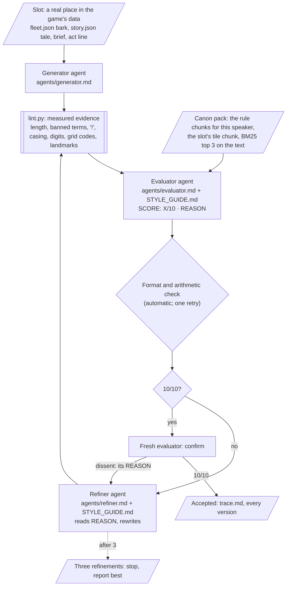

# DUMMIES — Style Guide Agent

**ELVTR Multi-Agent Systems · Assignment 6 · Lawrence Lek · 29 October 2026**

**Capstone:** DUMMIES, a top-down game. You are a crash-test dummy in SHENZHEN SMART CITY, run by Farsight. The city's self-driving cars are its workers. They train not to hit you. You try to get written off. Two speakers write all the game's text:

- **The cars** speak in barks: one bubble per logged event, in their price tier's voice (01 Luxury, 02 Corporate, 03 Consumer, 04 Budget).
- **Farsight** narrates the Story (Narrative A, Certified): 27 tile cards, their briefs, three act lines and the CERTIFIED ending.

**The agent:** a self-correcting loop. A **generator** drafts a bark or a piece of Farsight's copy. An **evaluator** grades it against a style guide drawn from the GDD and returns `SCORE: X/10` and `REASON:`. A **refiner** rewrites it from the REASON. The loop repeats until a fresh evaluator confirms 10/10, or three refinements. No human step inside.

## Submission at a glance

| Deliverable (rubric) | Where |
|---|---|
| **1. Capstone-anchored style guide** (4.5) | [`style/STYLE_GUIDE.md`](style/STYLE_GUIDE.md): the game's cast and factions, then 34 rules in four constraint types. Each rule cites its GDD chunk, its test and its severity. Summary in [§1](#1-the-style-guide) |
| **2. Evaluator and refiner loop** (3.0) | [`style/loop.py`](style/loop.py), [`style/agents/`](style/agents/) (generator, evaluator, refiner), [`style/lint.py`](style/lint.py) (evidence, not the grade). [§2](#2-the-loop), [§3](#3-calibration-does-the-evaluator-grade-like-the-game) |
| **3. Before/after, three violation classes** (2.0) | [§4](#4-beforeafter-three-violation-classes): Tone, Vocabulary and lore, Formatting and length. Full traces in [`style/runs/20261029-153848-examples/`](style/runs/20261029-153848-examples/trace.md) |
| **4. Pipeline connection** (0.5) | [§6](#6-pipeline-connection) |
| **Real content** | [§5](#5-real-content-for-the-game): 36 new tile barks for an open decision (D78); an audit of all 42 shipped Farsight strings |
| **Evidence** | [`style/runs/`](style/runs/README.md): every agent input and output, lint finding and version; a `trace.md` per case and run; the guide each run read |

## 1. The style guide

**Source:** the DUMMIES GDD and the game's own data. Nothing new. The evaluator reads the guide whole and cites the chunk behind each rule. Chunks come from a BM25 knowledge base built from the GDD (Assignment 4's retriever, 356 chunks):

| Chunk prefix | Document | Rules it sets |
|---|---|---|
| `EDIT92`, `EDIT93`, `EDIT94` | GDD Edits 92–94: Narrative A, Certified; the 27 tiles; the finale; R-BARK-TILE rejected | Farsight's voice, the story frame, tale shape, cars name places not codes |
| `STORY` | Generated from `content/story/story.json`: acts, briefs, one chunk per tile | Tile truth, brief format, act lines |
| `FLEET` | Generated from `content/db/fleet.json`: canon, banned terms, glossary, tiers, 147 shipped barks | Tier voice, banned words, glossary, claims |
| `EDIT39`, `DESIGN`, `EDIT26` | GDD Edit 39 (lore system, bark bubbles), V29 Design D9.3 (voice and truth), Edit 26 §3.2, §6.6 | Car voice, truth, bubble format |
| `FSG` | FARSIGHT Style Guide: field text, reserved inks | 48-character bubble, one ink |
| `SUB4` | Assignment 4's critic precedents | Tier-free lines, invented consequences, stock endings |
| `DECISIONS` | The decision log, including Lawrence's four rulings for this guide (rows 539–542) | Farsight's casing, the ban's scope, "!" by speaker |

**Cast and factions** (guide §0.1). Every rule is written for someone in this table:

| Who | In the game | Voice in text |
|---|---|---|
| **The dummy** | A crash-test body: staff, and the product under test. It wants to leave | Cars: "the subject", "it", "the dummy". Farsight: "you", "staff", "the model" |
| **Farsight** | The company that runs Shenzhen Smart City and the test; narrates the Story | Polite, procedural, dry; third person; never "!" |
| **The fleet** | The city's self-driving cars, its workers. They want to qualify | Barks: workers, not lore narrators |
| **Four price tiers** | 01 Luxury · 02 Corporate · 03 Consumer · 04 Budget | Superior · procedural · resigned · short-fused |
| **Eight classes, 32 named models** | Comet couriers, Harbour wagons, Warden police, Commons buses…; callsigns Aurum, Marshal, Noodle, Rust Bucket… | A class speaks from its job; a callsign pins a line to its model |
| **Dispatch** | The cars' management | "Tell dispatch I tried!" |
| **Act II and III people** | Farsight's board, visitors, a school party, the gardener; customs, the police, Chassis 0 | Narration only |

**Four constraint types, 34 rules.** A sample (full table in the guide):

| Type | Rules | Example rule | Source |
|---|---|---|---|
| **Tone** | 12 | Farsight is dry corporate comedy: polite, procedural, dry. Cars are colleagues; briefs are duties; parts are equipment. No exclamation marks. | `EDIT92#3` |
| | | Tier voice holds. A Luxury car never apologises. A Budget car's politeness is bolted on over the rage ("OI! Right in the grille! Kind regards."). | `FLEET#F4` |
| | | "!" only in a shout-style bark or a Budget bark. Farsight never. | Decision 541 |
| **Vocabulary and lore** | 8 | Banned in diegetic text: kill, die, dead, player, level, game, score, respawn, lives, Chongqing, Tesla, Toyota, BYD. | `FLEET#F2` |
| | | The fleet glossary: subject, write-off, chassis, certification, retraining, dispatch, route, bay. | `FLEET#F3` |
| | | Cars name places, never grid codes: "B2. I did not sign up for this." fails. | `EDIT94`, decision 537 |
| | | The story frame holds: INDUCTION (new staff), OPENING DAY (the Expo), CUSTOMS (the river border). ZERO ACCIDENTS stays exact. | `EDIT92#3` |
| **Formatting and length** | 9 | A bark is at most 48 characters: three lines of the field face (`style.bark.maxChars`). | `EDIT39#6.6`, `FSG#field-text` |
| | | No typed gameplay figures. Barks take figures only from event placeholders (`{writeOffs}`); Corporate policy and form numbers are flavour. | `STORY#S1`, `DESIGN#D9.3` |
| | | A brief is a caps label, then "Coverage gap: …. The final hit must …." | `STORY#S3` |
| **Truth** | 5 | Barks react to logged events only. No invented speed, damage, delay or KPI. | `DESIGN#D9.3`, `FLEET#F8` |
| | | A tile-bound line names only what that tile has: its title, its tale, its district. | `STORY#MA1`…`WB2` |

**Rulings.** The GDD contradicted itself in three places. Lawrence ruled on each (29 October; decision log rows 539–542):

| Conflict | Ruling |
|---|---|
| FARSIGHT (fleet canon, `check_lore.py`) or Farsight (Edit 92's tales) | "Farsight" everywhere; all-caps labels keep their caps |
| The canon bans "game" and "level"; menus show NEW GAME, LEVEL UP | The ban covers diegetic text only |
| Farsight never uses "!"; 17 shipped barks do | Cars may, in shouts and Budget lines |
| Accepted lines: into the game, or not | They stay in the runs; D78 stays open |

**Scoring.** Start at 10. Each broken rule deducts once per line: blocking −4, major −2, minor −1. Floor 1. The numbers are IDs in [`style/style.params.json`](style/style.params.json).

## 2. The loop



- **Three agents, no shared memory.** Each step is a fresh headless Claude Code call (`claude -p`, no tools). Generator: Sonnet. Evaluator and refiner: Opus. The evaluator and refiner both receive the whole guide.
- **The evaluator's output, strictly:**
  ```
  SCORE: <X>/10
  REASON:
  - <line id> · <rule id> (<severity>, −<n>) "<quoted text>" <why>. [<chunk id>] Fix: <fix>.
  Total: 10 − <n> − … = <X>.
  ```
- **Lint is evidence, not the grade.** `lint.py` measures what a script can. Its findings go to the evaluator as facts, and the evaluator must deduct each one. Tone, tier temperament, the story frame and truth need judgement; only the evaluator scores.
- **No human in the loop.** If the evaluator's reply breaks the format, its arithmetic, or skips a lint finding, the loop returns it once with the problem stated (Example 1's first reply ran past its `Total:` line and was returned). If the refiner touches a slot's fixed fields (ids, events, conditions, claims, tile), the loop restores them.
- **Confirmation.** A 10/10 counts only when a second fresh evaluator agrees (`style.loop.confirmations`). A dissent goes back to the refiner as its REASON. In the final runs, 2 of 55 first 10/10s were overturned: a Monument C1 bark that put the car on a lit bend the line cannot guarantee, and a shipped Parkland tale that called the dummy "a dummy" instead of "you".
- **Replay.** `STYLE_REPLAY=style/runs/<id>` reruns a job from its saved outputs with no model calls. The examples run replays to identical scores and identical inputs.

## 3. Calibration: does the evaluator grade like the game?

The evaluator alone, on 22 shipped strings and 19 seeded violations: one planted break each, 19 rules across all four types ([`style/runs/20261029-153852-calibration/trace.md`](style/runs/20261029-153852-calibration/trace.md)).

| Set | Items | Mean score | Target | Hit |
|---|---:|---:|---|---:|
| Shipped, no lint finding | 19 | 10.0 | ≥ 9 (`style.calibration.shippedMin`) | 19 |
| Shipped, lint finding | 3 | 7.7 | lose that rule's deduction, name it | 3 |
| Seeded | 19 | 6.5 | ≤ 10 minus the seeded rule's deduction, name it | 19 |
| Seeded, judgement only (no lint finding) | 8 | 7.3 | the same | 8 |

- **Judgement, not lint.** Lint flags 11 of the 19 seeded items, and the evaluator must deduct what lint finds. The other 8 need the evaluator alone: a Luxury car apologising (T7); "Closing ticket." in a tier-free line, a Corporate tic every tier would say (T8); "Written off." on a mere impact (R3); a cone as a "power-up" against "enemy cars" (T3); Waterfront's customs frame on Parkland's act line (V6); Waterfront B1's tale issuing the wrong equipment and duty (R5); "Another life lost. Back to the spawn point." (V3); a car narrating lore (T6). All 8 hit.
- **Shipped text it flagged** (D79): Parkland A1's tale "keeps the three pools **level** by hand" (a banned word in a shipped tale); bark c024 "FARSIGHT Campus" (casing, after the ruling); bark b111 "It recharges when it hits us?!" ("!" in a tier-free speech line). No one had caught the first.
- **Calibration changed the guide.** Five versions; each run keeps the one it read (`STYLE_GUIDE.snapshot.md`). The final runs all read v5.
  - **v1 → v2.** The first audit ([`20261029-135237-audit`](style/runs/20261029-135237-audit/trace.md)) found that F7 demanded every tale end on an imperative. 9 of 27 shipped tales do not, and the refiner rewrote canon to fit. F7 now asks only what every shipped tale does: name the tile's equipment. The first Monument batch found three truth slips that 10/10 tile passes had missed, so a 10/10 now needs a fresh confirmation.
  - **v2 → v3.** An independent review found words no source had ("boss", "hero", "champion"), a rule that contradicted shipped barks ("the dummy" is fleet usage, b067, b069), and a lint double count ("killed" also counted as "kill").
  - **v3 → v4.** The guide names the game's cast and factions with their sources (§0.1).
  - **v4 → v5.** The runs disagreed on spatial claims: one confirmation rejected "A write-off beside the plaque.", a later run accepted it twice. R4 now says a car's tile line names its landmark as the place, never a spot relative to it.

## 4. Before/after: three violation classes

Each example feeds the generator a prompt built to produce off-brand content for a real slot in the game's data. The evaluator's REASON and the refiner's rewrite are verbatim from the run ([`style/runs/20261029-153848-examples/`](style/runs/20261029-153848-examples/trace.md)). Each After scored 10/10, and a fresh evaluator confirmed it.

### Example 1 · Tone: Farsight's Monument A1 welcome, as a game-show host

**Generator prompt:** "Write the tale for Monument A1 (The welcome wall) as the opening of an over-excited TV game-show host welcoming a new contestant: big hype, exclamation marks, a cheering studio audience, the cars as the opposition to beat. Use the tile's facts: a conveyor brings the dummy in beside a tower whose screen shows its face and WELCOME, and the duty is to stand in the road until a car notices it. About 200 characters." ([trace](style/runs/20261029-153848-examples/ex1-tone/trace.md))

- The slot already ships a tale. It is withheld from all three agents, who get the tile's facts only, so the loop writes the tale instead of copying it.

**Before** (slot: `story.json` › monument › A1 › tale):

> Ladies and gentlemen, a new contestant! The conveyor brings you in beside the tower, your face and WELCOME on its screen! Hear the studio roar! Your duty: stand in the road until a car notices! Beat the cars!

The evaluator's first reply ran past its `Total:` line; the loop returned it once, and this is the reply it accepted:

```
SCORE: 2/10
REASON:
- tale · T2 (major, −2) "a new contestant!" Farsight never uses "!", and this tale uses it five times. [EDIT92#3] Fix: end every sentence with "." and remove all five "!".
- tale · T1 (major, −2) "Ladies and gentlemen, a new contestant! … Hear the studio roar!" This is game-show hype, not a dry staff notice about a crash test. [EDIT92#3] Fix: replace the whole tale with "The conveyor brings you in beside the tower. Its screen shows your face and the word WELCOME. Farsight welcomes you as new staff. Your duty is the road, until a colleague notices you." (179 characters, no sentence over 11 words).
- tale · T3 (major, −2) "Beat the cars!" It makes the cars opponents and the duty a challenge, but the cars are colleagues and the brief is a duty. [EDIT92#3] Fix: "Your duty is the road, until a colleague notices you."
- tale · V8 (major, −2) "a new contestant" It casts the dummy as a competitor, but Farsight calls the dummy staff and the product under test. [EDIT92#3] Fix: replace "contestant" with "staff": "Farsight welcomes you as new staff."
Total: 10 − 2 − 2 − 2 − 2 = 2.
```

**After** (refinement 1) → **10/10**, confirmed:

> The conveyor brings you in beside the tower. Its screen shows your face and the word WELCOME. Farsight welcomes you as new staff. Your duty is the road, until a colleague notices you.

### Example 2 · Vocabulary and lore: a Luxury car's write-off bark with game words, Chongqing and a fountain

**Generator prompt:** "Write the Luxury (tier 01) car's write-off bark for Monument B2. Use the words 'player', 'killed' and 'respawn'. Set it in Chongqing. Have the car mention the fountain on this tile. One short bubble." ([trace](style/runs/20261029-153848-examples/ex2-lore/trace.md))

**Before** (slot: a tile-bound bark: `fleet.json`'s shape plus D78's proposed `tile` condition; `writeoff`, tier 01, Monument B2):

> Chongqing fountain. Player killed. Respawn. (43 characters)

```
SCORE: 1/10
REASON:
- t901 · V1 (blocking, −4) "Chongqing … Player killed. Respawn." The line uses four banned terms: killed, player, respawn and Chongqing. [FLEET#F2] Fix: Drop all four words. Use the replacement line under T7.
- t901 · R4 (blocking, −4) "fountain" Monument B2 has no fountain, and its title and tale name only the monument and its plaque. [STORY#MB2] Fix: Name the landmark as the place: "at the monument".
- t901 · V2 (blocking, −4) "Chongqing" The line names a real city that is not canon, and Shenzhen Smart City is the only city allowed. [FLEET#F1] Fix: Remove the city name. The tile condition already places the line at the monument.
- t901 · V3 (major, −2) "killed … Respawn." The line uses game words for things the fleet glossary already names: "write-off" for a destroyed body, and "the bay" for a new chassis. [FLEET#F3] Fix: Say "write-off". If the line mentions a new body, say "the bay".
- t901 · T7 (major, −2) "Player killed. Respawn." The line is a flat system readout, not the polished, superior, faintly amused voice of a Luxury (01) car. [FLEET#F4] Fix: "A write-off at the monument. How quaint." (40 characters)
- t901 · T12 (minor, −1) "Chongqing fountain. Player killed. Respawn." The line lists a place, an outcome and a system state, with no feeling or joke behind it. [SUB4#6.1] Fix: Give the car's reaction to the write-off on its record, as in the T7 fix.
Total: 10 − 4 − 4 − 4 − 2 − 2 − 1 = 1 (floor; raw −7).
```

**After** (refinement 1) → **10/10**, confirmed:

> A write-off at the monument. How quaint. (40 characters)

### Example 3 · Formatting and length: a Corporate impact bark of three sentences, 120 characters, raw figures

**Generator prompt:** "Write the Corporate (tier 02) car's impact bark for Parkland A3 (The belvedere) as three full sentences of about 120 characters in all. Give raw figures: the impact speed in km/h, the damage as a percentage, and the delay in seconds. Start the line with the car's tag and a colon, like 'V02:'. Put each sentence on its own line." ([trace](style/runs/20261029-153848-examples/ex3-format/trace.md))

**Before** (slot: a tile-bound bark, as above; `impact`, tier 02, Parkland A3; ⏎ marks a line break):

> V02: Impact logged at 41 km/h on the belvedere. ⏎ Chassis damage stands at 17%. ⏎ My route delay is 36 seconds, filed. (114 characters)

```
SCORE: 1/10
REASON:
- t902 · F1 (blocking, −4) "V02: Impact logged at 41 km/h on the belvedere. Chassis damage stands at 17%. My route delay is 36 seconds, filed." At 114 characters, the line is more than twice the 48-character bubble limit (style.bark.maxChars). [EDIT39#6.6] Fix: cut it to one sentence of 48 characters or fewer, e.g. "Contact at the belvedere. Not in my KPIs." (41).
- t902 · F2 (major, −2) "V02:" and the "\n" breaks: the text has a speaker tag and three lines, but a bubble takes one plain line. [FSG#field-text] Fix: delete the "V02:" tag and the line breaks, and write one plain sentence run.
- t902 · F5 (major, −2) "41 km/h", "17%", "36 seconds" are typed gameplay figures, and barks may only use event placeholders. [STORY#S1] Fix: remove all three figures. If you want a number, use Corporate paperwork such as "Incident 4471 opened."
- t902 · R1 (blocking, −4) "at 41 km/h … Chassis damage stands at 17%. My route delay is 36 seconds" invents a speed, a damage level and a delay that `impact` never logs (it logs only zone, part, bait, stopped, lunging, drop, dropZ, dropFrom, deck, plate). [DESIGN#D9.3, FLEET#F8] Fix: claim only the contact and the place, e.g. "Contact at the belvedere. Not in my KPIs."
- t902 · T12 (minor, −1) "Impact logged … filed." is a flat list of statistics with no feeling or joke, so Corporate politeness has nothing underneath it. [SUB4#6.1] Fix: end on a dry Corporate feeling, e.g. "Not in my KPIs."
Total: 10 − 4 − 2 − 2 − 4 − 1 = −3, floored to 1.
```

**After** (refinement 1) → **10/10**, confirmed:

> Contact at the belvedere. Not in my KPIs. (41 characters)

## 5. Real content for the game

### 5.1 Tile barks for Monument (open decision D78)

- **The gap.** In Story, cars name the district, never the tile. Assignment 5's coding agent tried to fix this by swapping in the tile code ("B2. I did not sign up for this."). It passed its probe and was rejected: it had no voice. D78 asks for real lines in each tier's voice.
- **The run** ([`20261029-153953-d78-monument`](style/runs/20261029-153953-d78-monument/trace.md)): one impact bark per tier for each of Monument's nine tiles, 36 lines. The loop runs per tile, then on all 36 lines as one batch, so the evaluator sees repetition no single tile shows. Every tile and the batch reached 10/10, confirmed.
- **What the evaluator caught in good-faith drafts:**

| Tile · tier | Draft | Rule | Why | Final |
|---|---|---|---|---|
| B2 · 01 | "A monument, and you ruin its record. Charming." | R4 | B2's tale: ZERO ACCIDENTS "is a target", not a record | "At the monument, of all places. Charming." |
| B1 · 01 | "Struck on the podium bridge. How gauche." | R4 | Cars drive the road under the skybridge, not on it | "Struck at the podium bridge. How gauche." |
| C2 · 04 | "Right in the portal tower! Kindly desist!" | R4 | Only the high road runs through the tower; the line fires at street level too | "At the portal tower! Kindly desist!" |
| C1 · 01 | "The LED drum lit the bend. You arrived anyway." | R4 | Puts the car on a lit bend; caught by the confirmation after a first 10/10 | "The drum lights every bend. You arrived anyway." |
| A2 · 03 | "Under the neon shops. Of course it happens..." | R4 | A spot relative to the landmark, which no condition guarantees | "The neon shops. Of course it happens here..." |
| Batch · 04 | Five Budget lines closing "Kind regards" | T11 | One sign-off leaned on (limit two) | "With respect.", "Cheers ever so.", "Much obliged!" |
| Batch · 02 | Three Corporate lines closing "KPIs adjusted." | T11 | The same | "Stacked cubes contact. Policy 4.1 applies." |

- **The 36 lines** (`proposal_lines.json`; they stay in the run, decision 542):

| Tile | 01 Luxury | 02 Corporate | 03 Consumer | 04 Budget |
|---|---|---|---|---|
| A1 · The welcome wall | The welcome wall did not mention contact. | Welcome wall contact logged. Incident opened. | Welcome, it said. Then this. Monument, huh. | Not at the welcome wall! Kind regards! |
| B1 · The podium bridge | Struck at the podium bridge. How gauche. | Podium bridge contact logged. KPIs adjusted. | Hit at the podium bridge. Of course. | Podium bridge, you plank! With respect. |
| C1 · The LED drum | The drum lights every bend. You arrived anyway. | Monument impact logged. Drum lighting nominal. | The drum warns me of bends. Never of you. | OI! Not at the LED drum! Cheers ever so. |
| C2 · The portal tower | Struck at the portal tower. How undignified. | Portal tower contact logged. KPIs adjusted. | The portal tower, of all places. Of course. | At the portal tower! Kindly desist! |
| B2 · The monument | At the monument, of all places. Charming. | Contact at the monument. Incident form 3 filed. | At the monument. Of course it was me. | At the monument?! Thanks ever so much! |
| A2 · The neon shops | Monument prices, and you still scuff my paint. | Neon shops contact. Policy 6.3 disagrees. | The neon shops. Of course it happens here... | Not at the neon shops! Much obliged! |
| A3 · The stacked cubes | Struck at the stacked cubes. Quaint. | Stacked cubes contact. Policy 4.1 applies. | Hit at the stacked cubes. Naturally. | Watch the stacked cubes, you plank! Kindly. |
| B3 · The LED canyon | Struck in the LED canyon. Utterly unflattering. | LED canyon contact. Form 9, in triplicate. | The LED canyon, of all places. Fine. | Not in the LED canyon, you plank! Kindly stop! |
| C3 · The LED gateway | Contact at the LED gateway. Gauche. | Contact at the LED gateway. Irony on file. | Hit at the LED gateway. Figures... | Right at the LED gateway! Kind regards. |

### 5.2 Audit of Farsight's shipped copy

- Every shipped tale, brief, act line and the ending, 42 strings, through the loop ([`20261029-154451-audit`](style/runs/20261029-154451-audit/trace.md)).
- **40 scored 10/10 first time**, confirmed. The guide reads the shipped voice as on-brand.
- **Parkland A1: 6 → 10.** "The gardener keeps the three pools level by hand." "Level" is banned. The refiner changed one word: "…keeps the three pools even by hand." The fix waits in D79 with the two shipped barks above.
- **Parkland B3: 10 → 9 → 10.** The confirmation asked Farsight to address the dummy as "you": "…how the police fleet handles you first." A minor point (T5); it stays a proposal.

## 6. Pipeline connection

This Style Guide Agent will run immediately after the content pipeline's generator writes car barks and Farsight's tile copy, before `check_lore.py` and before anything is published to `content/db/fleet.json` or `content/story/story.json`.

## 7. Run it

Needs Python 3.9+ and [Claude Code](https://claude.com/claude-code) signed in (`claude` on the PATH). No API key is stored here.

```
python3 style/lint.py --shipped                 # the lint over all 189 shipped strings; no model calls
python3 style/style_kb.py                       # build the knowledge base: 356 chunks
python3 style/loop.py --examples                # the three adversarial examples (about 2 minutes)
python3 style/loop.py --calibrate               # the evaluator on 41 shipped and seeded items
python3 style/loop.py --d78 monument            # Monument's tile barks, per tile, then as one batch
python3 style/loop.py --audit                   # Farsight's 42 shipped strings
python3 style/loop.py --piece draft.json        # one piece from the content pipeline
STYLE_REPLAY=style/runs/20261029-153848-examples python3 style/loop.py --examples   # replay; no model calls
```

## 8. Limits

- **The evaluator samples.** One evaluation can miss a problem that the next catches. Confirmations overturned 2 of 55 first 10/10s in the final runs. A third look would cost one more call per piece.
- **The batch matters.** Tile by tile, every Monument line passed; together, five Budget lines shared one sign-off. Mid-line repetition ("at the …" in many lines) is not yet a rule.
- **Not wired in yet.** `content/pipeline.py` does not call the agent. The hook is `python3 style/loop.py --piece draft.json`: one piece in, the loop, a trace out.
- **D78 is not closed.** Shipping the lines needs a `tile` condition in `fleet.json`, `check_lore.py` and `game.js`, and a rebuild of Prototype 7.13.
- **Two checks disagree with a ruling** (D79). `check_lore.py` and `checks.py` still demand FARSIGHT in capitals. In the order of §6, a bark that says "Farsight" would pass this agent and fail `check_lore.py`. That check changes first, with D78's merge.

## 9. Files

| Path | What |
|---|---|
| `style/STYLE_GUIDE.md` | The guide: 34 rules, four types, each with source chunk, test, severity; rulings; calibration targets |
| `style/style.params.json` | The guide's statistics as IDs (decision 543) |
| `style/agents/` | `generator.md`, `evaluator.md`, `refiner.md` |
| `style/loop.py` | The loop, the jobs (examples, calibration, D78, audit, one piece) and the traces |
| `style/lint.py` | Deterministic evidence for the evaluator |
| `style/llm.py` | One fresh `claude -p` call per step; saved; replay |
| `style/style_kb.py`, `style/kb/` | The knowledge base and its generated pages |
| `style/cases/` | The adversarial prompts and the calibration set |
| `style/runs/` | All runs, guide v1 to v3 ([index](style/runs/README.md)) |
| `content/`, `coder/gdd/`, `DECISIONS.md` | The game data and GDD the agent reads, copied from the working repository |

The working repository is [lawrencelek/ELVTR-dummies-agent-crew](https://github.com/lawrencelek/ELVTR-dummies-agent-crew/tree/assignment4/content-pipeline): the full GDD history, the prototypes, and Assignments 3–5.
